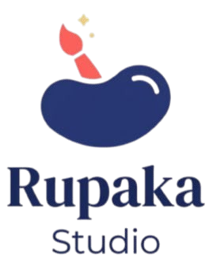
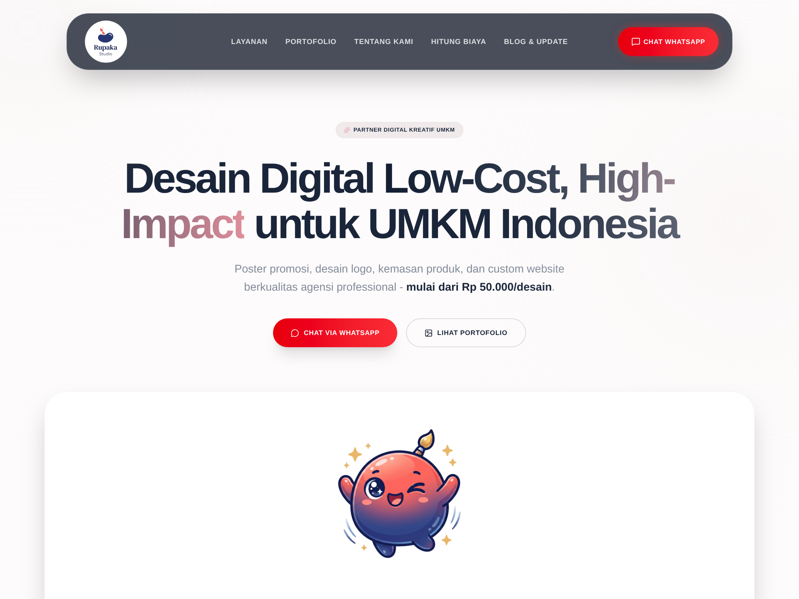
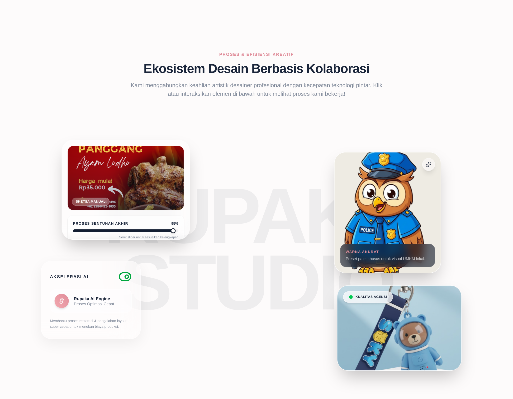
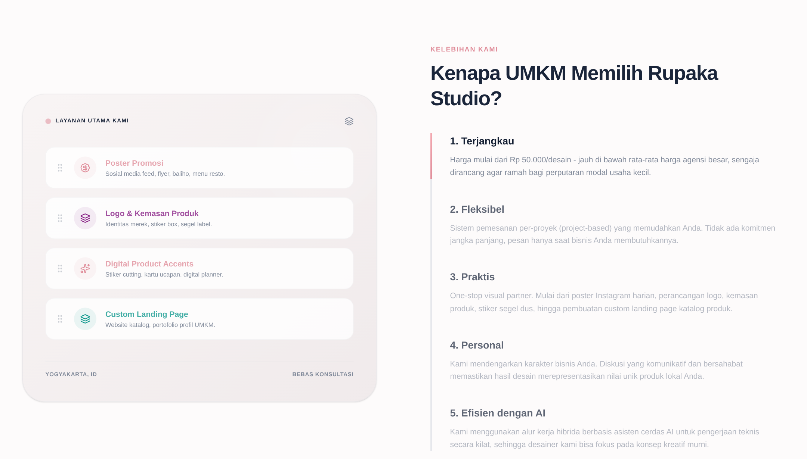
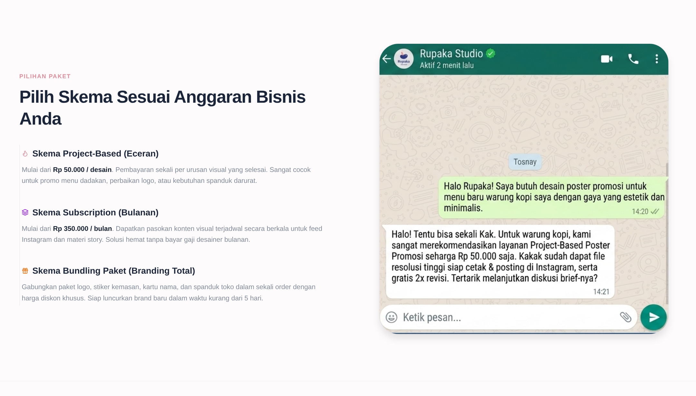
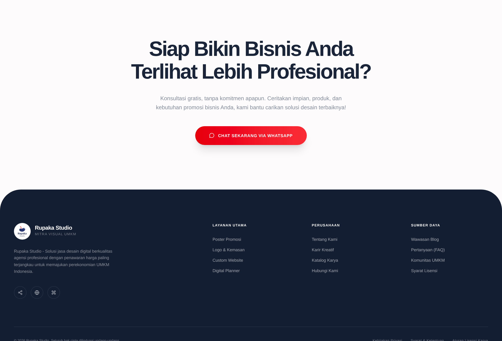
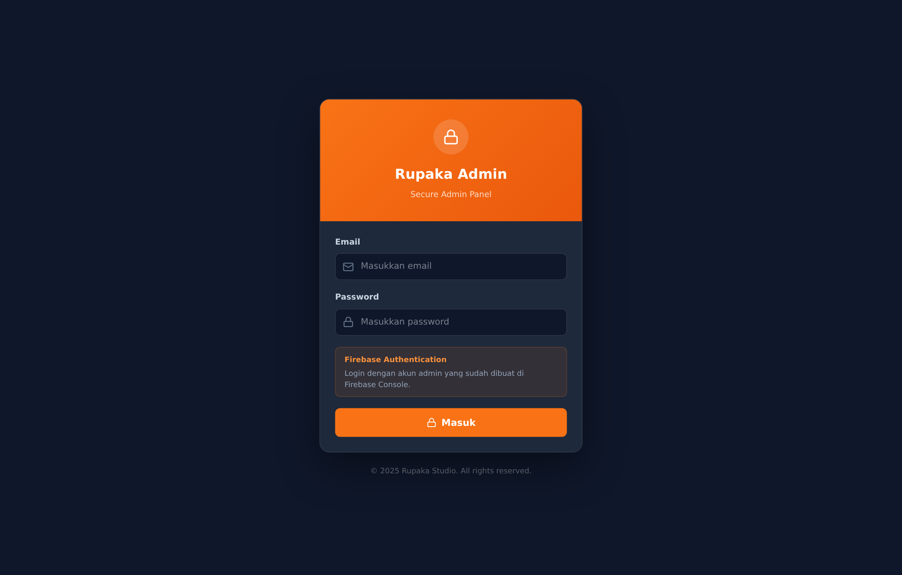
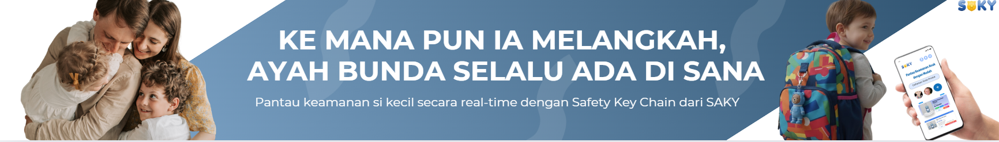

<div align="center">
  

  <h1>Rupaka Studio</h1>

  <p>
    <strong>Desain Digital <em>Low-Cost, High-Impact</em> untuk UMKM Indonesia</strong>
  </p>

  <p>
    Partner visual kreatif berbasis di Yogyakarta yang menghadirkan desain poster promosi, logo, kemasan produk, maskot, hingga custom website berkualitas agensi dengan harga ramah UMKM.
  </p>

  <p>
    <a href="https://rupaka-studio.vercel.app">
      
    </a>
    
    
    
    
    
  </p>

  <p>
    <a href="#tentang-rupaka-studio">Tentang</a> •
    <a href="#showcase-website--karya">Showcase</a> •
    <a href="#layanan--skema-paket">Layanan</a> •
    <a href="#fitur-website--cms">Fitur Platform</a> •
    <a href="#teknologi">Teknologi</a>
  </p>
</div>

---

## Tentang Rupaka Studio

Perkembangan era digital mengubah cara UMKM bersaing di pasar. **Rupaka Studio** hadir sebagai mitra strategis solusi desain digital yang dirancang khusus untuk membantu pertumbuhan usaha lokal di Yogyakarta dan seluruh Indonesia.

Dengan menggabungkan **sentuhan artistik desainer profesional** dan **alur kerja hibrida berbasis AI (*Hybrid Workflow*)**, Rupaka Studio mampu memangkas waktu produksi teknis tanpa mengorbankan karakter estetika. Hasilnya adalah karya visual berstandar agensi dengan biaya yang tetap bersahabat bagi pelaku usaha—**mulai dari Rp 50.000/desain**.

### Nilai Utama

| Pilar | Penjelasan |
| :--- | :--- |
| **Terjangkau** | Mulai dari Rp 50.000/desain, dirancang ramah terhadap perputaran modal UMKM. |
| **Fleksibel** | Tersedia sistem *project-based* (eceran) tanpa komitmen jangka panjang, berlangganan bulanan, hingga paket *bundling*. |
| **Praktis** | *One-stop visual partner* dari kebutuhan konten harian Instagram, identitas logo, kemasan produk, sampai landing page katalog. |
| **Personal** | Diskusi brief komunikatif dan bersahabat agar setiap karya merepresentasikan karakter unik produk lokal. |
| **Efisien dengan AI** | Akselerasi tahap teknis dan eksplorasi konsep menggunakan AI sehingga pengerjaan cepat dan presisi. |

---

## Showcase Website & Karya

### Tampilan Website (`rupaka-studio.vercel.app`)

<div align="center">
  
  <br />
  <sub><strong>Halaman Utama (Hero & Floating Navbar)</strong> — Navigasi glassmorphism, tipografi modern, tombol CTA WhatsApp, dan maskot resmi studio</sub>
</div>

<br />

<table>
  <tr>
    <td align="center" width="50%">
      
      <br />
      <sub><strong>Interactive Creative Collage</strong> — Kartu interaktif <em>draggable</em>, progress slider, & simulasi toggle Akselerasi AI</sub>
    </td>
    <td align="center" width="50%">
      
      <br />
      <sub><strong>Layanan Utama & Keunggulan</strong> — Kartu layanan interaktif dan 5 pilar nilai utama untuk UMKM</sub>
    </td>
  </tr>
  <tr>
    <td align="center" width="50%">
      
      <br />
      <sub><strong>Skema Anggaran & Konsultasi</strong> — Pilihan paket <em>Project-Based</em>, <em>Subscription</em>, dan <em>Bundling</em></sub>
    </td>
    <td align="center" width="50%">
      
      <br />
      <sub><strong>Final CTA & Footer</strong> — Ajakan konsultasi gratis via WhatsApp dan navigasi informasi studio</sub>
    </td>
  </tr>
  <tr>
    <td align="center" colspan="2">
      
      <br />
      <sub><strong>Admin Dashboard CMS (<code>/admin</code>)</strong> — Akses terproteksi Firebase Authentication untuk kelola portofolio, blog, testimoni, & FAQ</sub>
    </td>
  </tr>
</table>

### Karya Desain Pilihan

#### Poster Promosi & Kemasan Produk UMKM

<table>
  <tr>
    <td align="center" width="33%">
      
      <br />
      <sub><strong>Poster Promosi Kuliner</strong><br />Roemah Panggang — Pre-Order Menu</sub>
    </td>
    <td align="center" width="33%">
      
      <br />
      <sub><strong>Desain Kemasan Produk</strong><br />Basreng Rhadika Snack Pouch</sub>
    </td>
    <td align="center" width="33%">
      
      <br />
      <sub><strong>X-Banner Acara & Kuliner</strong><br />Bazar Kemerdekaan Tempo Doeloe</sub>
    </td>
  </tr>
</table>

#### Banner Promosi Digital & Lanskap

<table>
  <tr>
    <td align="center" width="50%">
      
      <br />
      <sub><strong>Banner Promosi Kuliner</strong> — Roemah Panggang</sub>
    </td>
    <td align="center" width="50%">
      
      <br />
      <sub><strong>Mockup Produk & Branding</strong> — SAKY Safety Keychain</sub>
    </td>
  </tr>
  <tr>
    <td align="center" colspan="2">
      
      <br />
      <sub><strong>Web Banner Promosi</strong> — Kampanye Produk SAKY GPS Tracker</sub>
    </td>
  </tr>
  <tr>
    <td align="center" colspan="2">
      
      <br />
      <sub><strong>Hero Banner E-Commerce</strong> — Kampanye Visual SAKY</sub>
    </td>
  </tr>
</table>

#### Identitas Logo, Maskot & Mockup 3D

<table>
  <tr>
    <td align="center" width="25%">
      
      <br />
      <sub><strong>Logo Brand</strong> — Aurra</sub>
    </td>
    <td align="center" width="25%">
      
      <br />
      <sub><strong>Logo Brand</strong> — LYNIX</sub>
    </td>
    <td align="center" width="25%">
      
      <br />
      <sub><strong>Mockup Merchandise</strong> — SAKY</sub>
    </td>
    <td align="center" width="25%">
      
      <br />
      <sub><strong>Ilustrasi Maskot</strong> — Expression Sheet</sub>
    </td>
  </tr>
</table>

---

## Layanan & Skema Paket

### Layanan Utama

- **Poster Promosi** — Konten feed & story media sosial, flyer promosi, menu restoran, hingga materi cetak baliho.
- **Logo & Kemasan Produk** — Perancangan identitas merek (file master vektor), label stiker kemasan, segel dus, dan visualisasi mockup.
- **Digital Product Accents** — Stiker cutting, kartu ucapan, *thank you card*, dan *digital planner*.
- **Custom Landing Page** — Website katalog produk dan profil bisnis UMKM yang modern dan responsif.

### Pilihan Skema Anggaran

1. **Skema Project-Based (Eceran)** — Mulai dari **Rp 50.000 / desain**. Cocok untuk kebutuhan promo mendadak, desain menu baru, atau pembaruan aset visual tertentu.
2. **Skema Subscription (Bulanan)** — Mulai dari **Rp 350.000 / bulan**. Pasokan konten visual terjadwal untuk media sosial secara rutin tanpa perlu merekrut desainer penuh waktu.
3. **Skema Bundling Paket (Branding Total)** — Paket lengkap logo, stiker kemasan, kartu nama, dan materi promosi toko dalam satu pesanan hemat untuk peluncuran brand baru.

---

## Fitur Website & CMS

Repositori ini merupakan aplikasi web lengkap **Rupaka Studio** yang terdiri dari **halaman publik interaktif** dan **panel Admin Dashboard CMS** terintegrasi dengan Firebase serta Cloudinary.

### 1. Halaman Publik (`/`)

- **Floating Glassmorphism Navbar** — Navigasi melayang dengan *smooth scroll* ke setiap bagian, laci menu responsif untuk perangkat mobile, dan tombol pintasan chat WhatsApp.
- **Hero & Trust Strip Marquee** — Tampilan utama dengan animasi halus, maskot studio, tombol aksi utama, serta marquee identitas layanan.
- **Interactive Creative Collage & Bento Grid** — Area interaktif dengan kartu *draggable* (desktop) dan grid bento (mobile), dilengkapi slider progres desain dan simulasi toggle **Akselerasi AI (Rupaka AI Engine)**.
- **Manifesto & Brand OS** — Penyajian filosofi studio, kartu layanan yang dapat digeser (*draggable*), sorotan 5 keunggulan utama, dan rincian skema paket.
- **Katalog Portofolio Filterable** — Galeri karya berdasarkan kategori (`Semua`, `Poster`, `Banner`, `Kemasan Product`) lengkap dengan **Modal Detail Proyek**, daftar *deliverables*, dan tombol pemesanan langsung via WhatsApp dengan pesan brief otomatis.
- **Testimoni Klien & FAQ Accordion** — Carousel ulasan pelanggan dengan rating bintang serta daftar pertanyaan umum yang dapat diperluas secara dinamis.
- **Blog & Wawasan UMKM** — Daftar artikel edukasi seputar desain, branding, dan pemanfaatan AI, dilengkapi **Slide-Over Article Reader** untuk membaca artikel penuh tanpa berpindah halaman.

### 2. Admin Dashboard CMS (`/admin`)

- **Autentikasi Terproteksi (`/admin/login`)** — Login admin aman berbasis Firebase Authentication dengan proteksi rute otomatis.
- **Dashboard Statistik** — Ringkasan jumlah portofolio, artikel blog, testimoni, dan FAQ secara terpusat.
- **Manajemen Portofolio (`/admin/portfolio`)** — Tambah, ubah, hapus, pencarian, filter kategori, pengaturan *publish/draft*, daftar fitur, serta unggah gambar langsung ke **Cloudinary**.
- **Manajemen Blog (`/admin/blog`)** — Pengelolaan artikel lengkap dengan kategori, penulis, estimasi waktu baca, gambar sampul, dan status publikasi.
- **Manajemen Testimoni (`/admin/testimonials`)** — Pengelolaan ulasan klien beserta sistem rating 1–5 bintang.
- **Manajemen FAQ (`/admin/faq`)** — Pengelolaan daftar tanya jawab dan pengurutan tampilan pada halaman utama.

---

## Teknologi

| Kategori | Teknologi | Peran |
| :--- | :--- | :--- |
| **Core Framework** | React 19, TypeScript, Vite 6 | Fondasi antarmuka SPA yang cepat dan *type-safe* |
| **Styling & UI** | Tailwind CSS v4, Lucide React | Sistem desain modern, responsif, dan ikonografi konsisten |
| **Animasi & Interaksi** | Motion (Framer Motion) | Transisi halus, kartu *draggable*, modal, dan animasi scroll |
| **Routing** | React Router DOM v7 | Pemisahan rute publik (`/`) dan panel admin (`/admin/*`) |
| **Backend & Database** | Firebase (Auth & Cloud Firestore) | Autentikasi admin serta penyimpanan data dinamis real-time |
| **Media Storage** | Cloudinary Upload API | Pengunggahan dan optimasi gambar portofolio & blog |
| **Deployment** | Vercel | Hosting produksi dengan SPA rewrite routing |

---

## Struktur Proyek

```text
Rupaka-Studio/
├── assets/                   # Aset visual brand, logo, maskot, dan karya showcase
├── public/                   # Aset statis publik
├── src/
│   ├── components/           # Komponen landing page (Navbar, Hero, CollageSection,
│   │                         # Manifesto, Features, Portfolio, TestimonialFaq, BlogSection, Footer)
│   ├── admin/                # Modul lengkap Admin Dashboard CMS
│   │   ├── components/       # DataTable, FormModal, Sidebar, Header, Toast
│   │   ├── hooks/            # Custom hooks state & notifikasi admin
│   │   ├── pages/            # Login, Dashboard, PortfolioAdmin, BlogAdmin, TestimonialAdmin, FAQAdmin
│   │   └── services.ts       # Layanan CRUD Firestore untuk konten CMS
│   ├── contexts/             # AuthContext (Firebase Authentication)
│   ├── hooks/                # Hook pengambilan data publik (usePublicData)
│   ├── lib/                  # Konfigurasi Firebase & integrasi upload Cloudinary
│   ├── App.tsx               # Susunan utama landing page Rupaka Studio
│   ├── AppRouter.tsx         # Konfigurasi routing publik dan proteksi admin
│   └── data.ts               # Data awal/fallback portofolio, blog, testimoni, dan FAQ
├── firestore.rules           # Aturan keamanan database Cloud Firestore
├── storage.rules             # Aturan akses storage
└── vercel.json               # Konfigurasi routing SPA pada Vercel
```

---

<div align="center">
  <p>
    <strong>Rupaka Studio</strong> — Mitra Visual UMKM Indonesia
  </p>
  <p>
    <a href="https://rupaka-studio.vercel.app">Kunjungi Website</a> •
    <a href="https://wa.me/6285604323512">Konsultasi via WhatsApp</a>
  </p>
  <p><sub>© 2026 Rupaka Studio. Yogyakarta, Indonesia.</sub></p>
</div>
